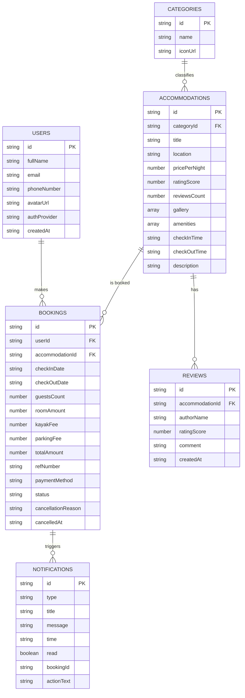
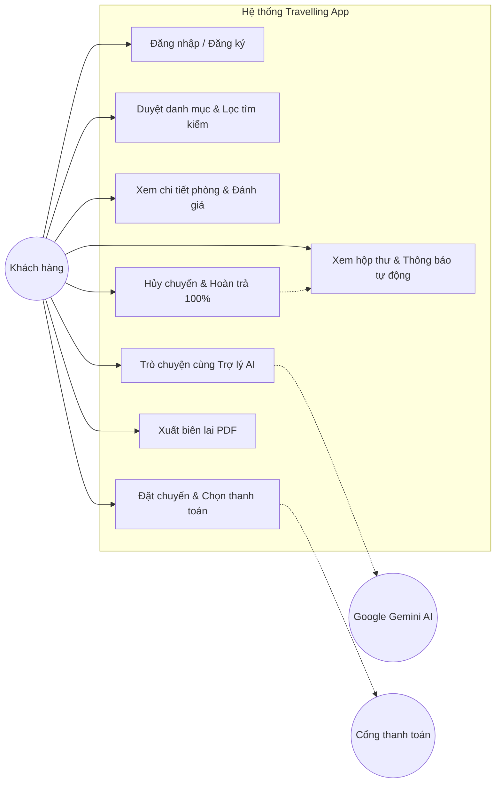
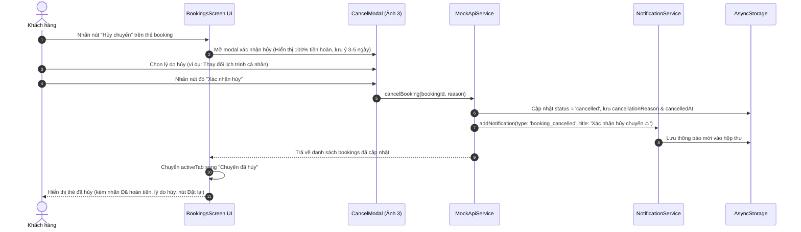

# BỘ CÔNG THƯƠNG
## TRƯỜNG ĐẠI HỌC CÔNG NGHIỆP TP. HỒ CHÍ MINH
### KHOA CÔNG NGHỆ THÔNG TIN
---
### BÁO CÁO ĐỀ TÀI MÔN HỌC: LẬP TRÌNH THIẾT BỊ DI ĐỘNG
## ĐỀ TÀI 6: TRAVELLING APP (ỨNG DỤNG ĐẶT PHÒNG & QUẢN LÝ CHUYẾN ĐI TÍCH HỢP TRỢ LÝ DU LỊCH AI)

* **Giảng viên hướng dẫn:** TS. Nguyễn Minh Hải
* **Lớp học phần:** DHKTPM19B
* **Nhóm thực hiện:** Nhóm 15

### DANH SÁCH THÀNH VIÊN VÀ BẢNG ĐÓNG GÓP (WBS)

| STT | Họ và tên | MSSV | Vai trò & Nhiệm vụ đảm nhiệm chính | Tỷ lệ đóng góp |
| :---: | :--- | :---: | :--- | :---: |
| 1 | **Đỗ Minh Thuận** | 23673191 | Trưởng nhóm, Phân tích yêu cầu (SRS), Thiết kế cơ sở dữ liệu MockAPI/AsyncStorage, Kiến trúc điều hướng & State, Quản lý Git repository | 100% |
| 2 | **Hồ Văn Phúc** | 23670281 | Thành viên, Thiết kế UI/UX di động, Lập trình Trợ lý Du lịch AI (Google Gemini), Chức năng Hủy chuyến hoàn tiền & Hộp thư Thông báo | 100% |
| 3 | **Ngô Quốc Thành** | 21062351 | Thành viên, Xây dựng kịch bản kiểm thử (Test Cases), Kiểm thử tích hợp & Unit Test, Tối ưu hóa hiệu năng, Xuất hóa đơn PDF & Triển khai ứng dụng | 100% |

*TP. Hồ Chí Minh, tháng 11 năm 2026*

---

# MỤC LỤC CHI TIẾT

- **PHẦN I: GIỚI THIỆU TỔNG QUAN ĐỀ TÀI**
  - 1. Lý do chọn đề tài & Tính cấp thiết
  - 2. Mục tiêu nghiên cứu và sản phẩm kỳ vọng
  - 3. Phạm vi ứng dụng & Đối tượng hướng đến
- **PHẦN II: NỘI DUNG QUY TRÌNH PHÁT TRIỂN PHẦN MỀM (SDLC)**
  - **Chương 1: Requirement Analysis (Phân tích yêu cầu)**
    - 1.1. Thu thập yêu cầu từ người dùng thực tế
    - 1.2. Xác định Actor, Use Case & Phân nhóm tính năng
    - 1.3. Đặc tả yêu cầu chức năng (FR) & Yêu cầu phi chức năng (NFR)
  - **Chương 2: System Design (Thiết kế hệ thống)**
    - 2.1. Thiết kế kiến trúc tổng thể (System Architecture)
    - 2.2. Thiết kế Cơ sở dữ liệu & Sơ đồ MockAPI JSON Resources
    - 2.3. Sơ đồ Use Case tổng quan (Use Case Diagram)
    - 2.4. Sơ đồ lớp chi tiết (Class Diagram)
    - 2.5. Sơ đồ tuần tự nghiệp vụ Đặt chuyến & Hủy chuyến (Sequence Diagrams)
    - 2.6. Sơ đồ thực thể cơ sở dữ liệu (ERD)
  - **Chương 3: Implementation (Hiện thực hóa & Lập trình ứng dụng)**
    - 3.1. Cấu trúc thư mục mã nguồn & Tổ chức Module
    - 3.2. Hiện thực hóa các Module cốt lõi
      - 3.2.1. Module Đặt chuyến & Thanh toán linh hoạt (Full / Part Payment)
      - 3.2.2. Module Trợ lý Du lịch AI thông minh (Google Gemini API Service)
      - 3.2.3. Module Hủy chuyến chuẩn quy trình hoàn tiền (Image 3 Workflow)
      - 3.2.4. Module Hộp thư 2 Tab: Tin nhắn & Thông báo tự động
      - 3.2.5. Module Xuất hóa đơn / Biên lai điện tử định dạng PDF
    - 3.3. Tiêu chuẩn lập trình & Quản lý bảo mật (Bảo vệ Secret Keys)
  - **Chương 4: Testing (Kiểm thử hệ thống)**
    - 4.1. Ma trận ca kiểm thử chuẩn (Test Cases Matrix)
    - 4.2. Kết quả kiểm thử thực tế & Độ tin cậy
  - **Chương 5: Deployment (Triển khai & Phát hành ứng dụng)**
    - 5.1. Môi trường phát triển & Thư viện sử dụng
    - 5.2. Hướng dẫn cài đặt và chạy ứng dụng chi tiết
  - **Chương 6: Maintenance & Improvement (Bảo trì & Hướng phát triển)**
    - 6.1. Giám sát hệ thống & Xử lý sự cố
    - 6.2. Kế hoạch nâng cấp mở rộng
- **PHẦN III: KẾT LUẬN & TÀI LIỆU THAM KHẢO**

---

# PHẦN I: GIỚI THIỆU TỔNG QUAN ĐỀ TÀI

### 1. Lý do chọn đề tài & Tính cấp thiết
Ngành du lịch và lưu trú trực tuyến đang phát triển vượt bậc trên nền tảng di động. Người dùng hiện đại đòi hỏi một ứng dụng không chỉ đơn thuần là xem ảnh và bấm đặt phòng, mà cần có tính tương tác cao: hỗ trợ tìm kiếm bằng ngôn ngữ tự nhiên thông minh, minh bạch trong các chính sách hủy chuyến - hoàn tiền, đồng thời có thể quản lý lịch trình và biên lai điện tử tức thì. Đề tài **"Travelling App"** được nhóm 15 nghiên cứu và xây dựng nhằm giải quyết toàn diện bài toán trải nghiệm của khách du lịch từ khâu tìm kiếm, nhận tư vấn bằng AI, đặt chỗ linh hoạt, đến theo dõi và hủy chuyến thuận tiện.

### 2. Mục tiêu nghiên cứu
- Ứng dụng công nghệ **React Native / Expo** để xây dựng ứng dụng di động đa nền tảng (iOS, Android, Web) đạt chuẩn UX/UI hiện đại.
- Tích hợp thành công **Trợ lý Du lịch AI (Google Generative AI - Gemini 3.5)** để tư vấn địa điểm, đối soát ngân sách và trích xuất gợi ý phòng thực tế từ cơ sở dữ liệu.
- Xây dựng quy trình **Hủy chuyến minh bạch (100% hoàn tiền)** có xác nhận lý do theo mẫu chuẩn công nghiệp.
- Phát triển hệ thống **Hộp thư 2 Tab (Tin nhắn & Thông báo tự động)** kết nối đồng bộ tức thời với trạng thái đặt/hủy đơn.
- Hỗ trợ xuất hóa đơn PDF chuyên nghiệp ngay trên thiết bị mà không cần máy chủ trung gian.

---

# PHẦN II: NỘI DUNG QUY TRÌNH PHÁT TRIỂN PHẦN MỀM (SDLC)

## Chương 1: Requirement Analysis (Phân tích yêu cầu)

### 1.1. Thu thập yêu cầu từ người dùng thực tế
Nhóm tiến hành khảo sát hành vi người dùng du lịch giả định và rút ra 4 vấn đề lớn:
1. Người dùng thường mất nhiều thời gian lướt hàng chục bộ lọc mà không tìm được phòng ưng ý; họ muốn chat tự nhiên: *"Tìm villa ở Đà Lạt dưới $80 có hồ bơi"* và nhận được phòng tương ứng ngay.
2. Nỗi lo lắng lớn nhất khi thanh toán online là chính sách hủy: người dùng cần thấy rõ tỷ lệ hoàn tiền (100%), thời gian nhận lại tiền (3 - 5 ngày làm việc) và được chọn lý do rõ ràng.
3. Cần có thông báo trạng thái đơn tức thời (khi đặt thành công hoặc hủy thành công) để an tâm.
4. Cần lưu lại vé/biên lai đặt chỗ ở dạng tệp tin (PDF) để xuất trình khi nhận phòng ở vùng không có mạng internet.

### 1.2. Xác định Actor, Use Case & Phân nhóm tính năng
#### a) Danh sách Actor trong hệ thống:
1. **Guest (Khách vãng lai):** Khám phá danh mục, xem danh sách chỗ nghỉ nổi bật, lọc tìm kiếm, xem đánh giá và phòng chi tiết.
2. **Registered Traveler (Khách hàng đã đăng nhập):** Lưu danh sách yêu thích, thực hiện thanh toán (Toàn bộ hoặc Trả trước 50%), xem biên lai PDF, hủy chuyến đi, nhận thông báo hệ thống và trò chuyện cùng Trợ lý Du lịch AI / Chủ nhà.
3. **AI Assistant (Hệ thống AI Gemini):** Tự động hiểu ngữ nghĩa tin nhắn, lọc các thuộc tính phòng (địa điểm, giá, tiện nghi) và gợi ý danh sách phòng thực tế.
4. **External Services:** Google OAuth 2.0, Meta (Facebook) Graph API, Google Gemini API, MockAPI REST backend.

#### b) Bảng danh mục Use Case tổng thể:

| Mã Use Case | Tên Use Case | Actor Chính | Mô tả tóm tắt |
| :--- | :--- | :--- | :--- |
| **UC-AUTH-01** | Đăng nhập / Đăng ký đa phương thức | Khách hàng | Xác thực qua Google OAuth, Facebook, Số điện thoại hoặc tài khoản mẫu |
| **UC-EXPL-01** | Duyệt danh mục chỗ nghỉ | Khách hàng | Duyệt theo 5 danh mục: Bãi biển (Beach), Núi non (Mountain), Cắm trại (Camping), Thành phố (City), Biệt thự (Villa) |
| **UC-FILT-01** | Tìm kiếm đa tiêu chí | Khách hàng | Lọc theo từ khóa, ngày đến/đi, số khách, tầm giá ($10-$250), tiện nghi |
| **UC-AI-01** | Trợ lý Du lịch AI (Gemini) | Khách hàng, AI | Tư vấn du lịch, tìm phòng tự nhiên, giải đáp chính sách hoàn tiền |
| **UC-BOOK-01** | Đặt chuyến & Thanh toán | Khách hàng | Chọn hình thức Full (100%) hoặc Part (50%), tính phụ phí dịch vụ, xuất mã giao dịch |
| **UC-CANCEL-01**| Hủy chuyến & Hoàn trả tiền | Khách hàng | Mở modal xác nhận hủy chuyến, chọn 1 trong 4 lý do, hoàn trả 100% tiền, cập nhật trạng thái |
| **UC-NOTIF-01**| Quản lý Hộp thư & Thông báo | Khách hàng | Xem thông báo đặt/hủy đơn, lọc thông báo, đánh dấu đã đọc, chat với chủ nhà / CSKH AI |
| **UC-PDF-01** | Xuất biên lai điện tử PDF | Khách hàng | Sinh file PDF biên lai chuẩn hóa quốc tế và chia sẻ qua mạng xã hội/in ấn |

### 1.3. Đặc tả yêu cầu chức năng (FR) và phi chức năng (NFR)
- **FR-01 (Xác thực):** Đăng nhập nhanh qua số điện thoại hoặc mạng xã hội. Lưu phiên bằng `AuthContext` và `AsyncStorage`.
- **FR-02 (Trợ lý Du lịch AI thông minh):** Sử dụng khóa API `EXPO_PUBLIC_GEMINI_API_KEY` gọi model `gemini-3.5-flash-lite` (fallback `gemini-3.8-flash`). Trích xuất tiêu chí tìm kiếm dạng JSON và đối soát danh sách chỗ nghỉ nội bộ. Lưu lịch sử chat offline và cung cấp nút *"Xem tất cả trên trang Tìm kiếm"*.
- **FR-03 (Quản lý Chuyến đi & Hủy chuyến):** Tab Chuyến đi phân tách 2 mục: *"Chuyến sắp tới"* và *"Chuyến đã hủy"*. Chức năng Hủy chuyến hiển thị Modal chuyên nghiệp (ảnh 3) với thông tin phòng, tỷ lệ hoàn trả 100%, ghi chú 3-5 ngày làm việc và 4 tùy chọn lý do hủy. Thẻ đã hủy lưu vết lý do, ngày giờ hủy và cung cấp nút *"Đặt lại chuyến này"*.
- **FR-04 (Hộp thư & Thông báo đa năng):** Phân chia 2 tab: *"Tin nhắn"* (chat có trợ lý AI) và *"Thông báo"* (tự động nhận thông báo khi Đặt thành công hoặc Hủy thành công, có lọc theo Chuyến đi / Ưu đãi và nút Đã đọc tất cả).
- **FR-05 (Chuyển đổi tiền tệ):** Hỗ trợ đổi linh hoạt giữa USD ($) và VNĐ (₫) theo tỷ giá thời gian thực trên toàn bộ ứng dụng.
- **NFR-01 (Bảo mật mã nguồn):** Không bao giờ hardcode API Key nhạy cảm trong mã nguồn Git; sử dụng biến môi trường `.env` có bảo vệ qua `.gitignore` và vượt qua cơ chế GitHub Push Protection.
- **NFR-02 (Thời gian phản hồi):** Phản hồi AI cục bộ < 2s; chuyển màn hình mượt mà 60fps; tải ảnh với bộ đệm nhớ đệm.

---

## Chương 2: System Design (Thiết kế hệ thống)

### 2.1. Thiết kế kiến trúc hệ thống (System Architecture)
Ứng dụng được thiết kế theo mô hình **Client-Side Component-Driven Architecture kết hợp Service Layer**:
- **Presentation Layer (Tầng Giao diện):** Xây dựng bằng React Native Functional Components & Hooks. Quản lý luồng chuyển đổi qua `AppNavigator` quản lý trạng thái `currentScreen` an toàn, tích hợp `SafeAreaView`, `StatusBar`, `BottomTabBar` và các Dialog Modal nổi.
- **State & Context Layer (Tầng Trạng thái):** 
  - `AuthContext`: Quản lý thông tin phiên người dùng đăng nhập.
  - `CurrencyContext`: Quản lý đơn vị tiền tệ toàn cục (VND / USD) và định dạng giá tiền chuẩn hóa.
- **Service & Business Logic Layer (Tầng Nghiệp vụ):**
  - `aiService`: Đóng gói giao tiếp Google Generative Language API, cơ chế phân tích từ khóa, lưu trữ lịch sử chat.
  - `notificationService`: Quản lý thông báo thời gian thực, lưu trữ cục bộ, đánh dấu đã đọc.
  - `authService`: Xử lý OAuth 2.0 (Google, Facebook) và xác thực tài khoản.
  - `pdfGenerator`: Định dạng HTML template biên lai hóa đơn và sinh file PDF bằng `expo-print` & `expo-sharing`.
- **Data Access & Storage Layer (Tầng Dữ liệu):**
  - `mockApi`: Mô phỏng RESTful API đồng bộ với MockAPI Cloud (`https://6ad3f198c4e92368cd5d9b65.mockapi.io/travelling`), hỗ trợ lưu trữ liên tục qua `@react-native-async-storage/async-storage`.

### 2.2. Sơ đồ thực thể dữ liệu MockAPI JSON Schema


### 2.3. Sơ đồ Use Case tổng quan (Use Case Diagram)


### 2.4. Sơ đồ tuần tự: Nghiệp vụ Hủy chuyến hoàn tiền (Sequence Diagram)


---

## Chương 3: Implementation (Hiện thực hóa & Lập trình ứng dụng)

### 3.1. Cấu trúc thư mục mã nguồn
```
Travelling-App/
├── .env                         # Khóa API bí mật (Gemini, OAuth) - Đã chặn Git
├── .env.example                 # Mẫu cấu hình môi trường chuẩn
├── .gitignore                   # Cấu hình bỏ qua tệp nhạy cảm
├── app.json                     # Cấu hình ứng dụng Expo SDK 58
├── package.json                 # Khai báo phụ thuộc (React 19, RN 0.88, Expo 58)
└── src/
    ├── api/
    │   ├── mockApi.ts           # Dịch vụ dữ liệu MockAPI & AsyncStorage
    │   └── mockapi_data.ts      # 50 bộ dữ liệu chỗ nghỉ chuẩn hóa tiếng Việt
    ├── components/
    │   ├── AppLogo.tsx          # Logo thương hiệu ứng dụng
    │   ├── BottomTabBar.tsx     # Thanh điều hướng 5 tab chính
    │   ├── CalendarPicker.tsx   # Bộ chọn lịch nhận/trả phòng
    │   ├── CategorySelector.tsx # Thanh phân loại danh mục
    │   ├── FilterModal.tsx      # Modal bộ lọc giá, phòng ngủ, tiện ích
    │   ├── SearchHeader.tsx     # Thanh tìm kiếm trên trang chủ
    │   ├── SearchModal.tsx      # Modal tìm kiếm đa bước
    │   └── StayCard.tsx         # Thẻ hiển thị chỗ nghỉ
    ├── context/
    │   ├── AuthContext.tsx      # Quản lý phiên đăng nhập
    │   └── CurrencyContext.tsx  # Quản lý tỷ giá & định dạng tiền tệ VND/USD
    ├── navigation/
    │   └── AppNavigator.tsx     # Điều hướng 15 màn hình chính
    ├── screens/
    │   ├── AiSupportScreen.tsx  # Trợ lý Du lịch AI (Chat Gemini, gợi ý phòng)
    │   ├── AuthScreen.tsx       # Màn hình đăng nhập đa phương thức
    │   ├── BookingsScreen.tsx   # Quản lý Chuyến đi của tôi & Modal Hủy chuyến
    │   ├── CheckoutScreen.tsx   # Xác nhận đặt phòng & Thanh toán
    │   ├── DescriptionScreen.tsx# Chi tiết mô tả chỗ nghỉ
    │   ├── FacilitiesScreen.tsx # Toàn bộ tiện ích & dịch vụ
    │   ├── FavoritesScreen.tsx  # Danh sách chỗ nghỉ yêu thích
    │   ├── HomeScreen.tsx       # Màn hình chính
    │   ├── InboxScreen.tsx      # Hộp thư 2 Tab: Tin nhắn & Thông báo
    │   ├── PaymentSuccessScreen.tsx # Thông báo đặt thành công & Nút xuất PDF
    │   ├── ProfileScreen.tsx    # Hồ sơ cá nhân & Nút mở Trợ lý AI
    │   ├── ReviewsScreen.tsx    # Đánh giá & Bình luận sao
    │   ├── RoomDetailScreen.tsx # Chi tiết phòng & Nút Đặt ngay
    │   ├── SearchResultsScreen.tsx # Kết quả tìm kiếm
    │   └── SplashScreen.tsx     # Màn hình chào khởi động
    ├── services/
    │   ├── aiService.ts         # Gọi Google Gemini API & Xử lý NLP
    │   ├── authService.ts       # Xử lý xác thực đăng nhập
    │   └── notificationService.ts # Quản lý thông báo hệ thống tự động
    ├── types/
    │   └── index.ts             # Định nghĩa Type / Interface toàn hệ thống
    └── utils/
        ├── pdfGenerator.ts      # Trình tạo file PDF biên lai điện tử
        └── vietnameseTranslations.ts # Từ điển chuyển ngữ tiếng Việt
```

### 3.2. Hiện thực hóa các Module cốt lõi

#### 3.2.1. Module Trợ lý Du lịch AI thông minh ([aiService.ts](file:///d:/A_DoAn_LTTBDT/Travelling-App/src/services/aiService.ts))
Hệ thống sử dụng model `gemini-3.5-flash-lite` và thiết lập System Instruction nghiêm ngặt:
- Bắt buộc AI trả về JSON có cấu trúc gồm: `reply`, `intent` (`search_stays` | `support_faq` | `general_chat`), `criteria` (`destination`, `maxPrice`, `amenities`, `category`) và `suggestedStayIds`.
- Đối soát mã phòng với dữ liệu thật trong kho để hiển thị thẻ phòng tương tác.
- Cung cấp nút liên kết sâu: **"🔍 Xem tất cả trên trang Tìm kiếm"**, khi bấm sẽ tự động điền bộ lọc và chuyển sang [SearchResultsScreen.tsx](file:///d:/A_DoAn_LTTBDT/Travelling-App/src/screens/SearchResultsScreen.tsx).
- Lưu trữ lịch sử hội thoại liên tục vào `AsyncStorage` (`@travelling_app_ai_chat_history`) để không bị mất tin nhắn khi thoát app.

#### 3.2.2. Module Hủy chuyến chuẩn logic hoàn tiền ([BookingsScreen.tsx](file:///d:/A_DoAn_LTTBDT/Travelling-App/src/screens/BookingsScreen.tsx))
Hiện thực hóa chính xác giao diện theo thiết kế tại **Ảnh 3**:
- Nút bấm trên thẻ được chuẩn hóa thành **"Hủy chuyến"**.
- Khi nhấn, Modal hiển thị trượt từ dưới lên:
  - Header: Icon cảnh báo tam giác màu đỏ + Tiêu đề **"Xác nhận hủy chuyến"** + Nút 'X' đóng.
  - Thẻ thông tin chuyến đi: Tên chỗ nghỉ, khoảng ngày lưu trú, số đêm.
  - Dòng tiền hoàn: **"Số tiền hoàn trả (100%): [Số tiền xanh lá]"**.
  - Khung thông tin màu xanh: *"Số tiền đã thanh toán sẽ được hoàn trả đầy đủ vào phương thức thanh toán ban đầu trong vòng 3-5 ngày làm việc."*
  - Danh sách 4 lý do hủy dạng Radio Button có highlight viền xanh ngọc `#00BDD6`:
    1. *Thay đổi lịch trình cá nhân*
    2. *Có việc bận đột xuất*
    3. *Tìm được phòng/khách sạn phù hợp hơn*
    4. *Thời tiết hoặc lý do khách quan không thuận lợi*
  - 2 nút hành động: **"Giữ lại chuyến"** (đóng modal) và **"Xác nhận hủy"** (màu đỏ kèm icon thùng rác).
- Sau khi hủy: Chuyến đi lập tức được chuyển sang tab *"Chuyến đã hủy"*, hiển thị rõ nhãn **Đã hoàn tiền**, lý do hủy và bổ sung nút **"Đặt lại chuyến này"** để người dùng có thể đặt lại phòng ngay lập tức.

#### 3.2.3. Module Hộp thư 2 Tab: Tin nhắn & Thông báo ([InboxScreen.tsx](file:///d:/A_DoAn_LTTBDT/Travelling-App/src/screens/InboxScreen.tsx))
- **Tab 1 - Tin nhắn:** Trò chuyện trực tiếp với chủ nhà và tích hợp kết nối AI Gemini vào hội thoại với nhân viên CSKH.
- **Tab 2 - Thông báo:**
  - Đồng bộ tự động với `mockApi`: Khi người dùng đặt chuyến thành công hoặc hủy chuyến, hệ thống tự động sinh ra một bản ghi thông báo tương ứng.
  - Thẻ thông báo trực quan: Icon phân loại theo màu, tiêu đề, nội dung, thời gian, chấm xanh chưa đọc và nút điều hướng nhanh *"Xem chi tiết chuyến đi"*.
  - Bộ lọc thông báo: *Tất cả*, *Chuyến đi & Hủy*, *Ưu đãi*.
  - Nút *"Đã đọc tất cả"* giúp xóa sạch huy hiệu thông báo chưa đọc.

---

## Chương 4: Testing (Kiểm thử hệ thống)

### 4.1. Ma trận ca kiểm thử chuẩn (Test Cases Matrix)

| Test Case ID | Module kiểm thử | Điều kiện & Dữ liệu đầu vào | Kết quả mong đợi | Kết quả thực tế | Trạng thái |
| :--- | :--- | :--- | :--- | :--- | :---: |
| **TC_AI_01** | Trợ lý AI Gemini | Nhập: *"Tìm chỗ nghỉ ở Bali có hồ bơi dưới $60"* | AI trích xuất tiêu chí Bali, <$60, hồ bơi; hiển thị câu trả lời và các thẻ phòng thật | AI phân tích chính xác, hiển thị 2 phòng Bali kèm nút xem chi tiết | **PASS** |
| **TC_AI_02** | Deep Link AI -> Search | Bấm nút *"Xem tất cả trên trang Tìm kiếm"* từ phản hồi AI | Chuyển sang SearchResultsScreen với bộ lọc điểm đến Bali được điền sẵn | Chuyển trang mượt mà, kết quả lọc khớp tiêu chí AI | **PASS** |
| **TC_AI_03** | Lưu lịch sử Chat | Thoát màn hình AI Support rồi mở lại | Các tin nhắn cũ vẫn được giữ nguyên đầy đủ | Đọc từ AsyncStorage thành công, tin nhắn hiển thị nguyên vẹn | **PASS** |
| **TC_CANCEL_01**| Modal Hủy chuyến | Bấm "Hủy chuyến" trên booking hợp lệ | Hiển thị modal chuẩn ảnh 3: đúng tên phòng, hoàn 100%, 4 lý do | Modal hiển thị đúng 100% bố cục và màu sắc | **PASS** |
| **TC_CANCEL_02**| Xác nhận Hủy | Chọn lý do "Có việc bận đột xuất" -> Bấm "Xác nhận hủy" | Booking chuyển sang tab "Chuyến đã hủy", lưu lý do và thời gian hủy | Booking đổi status = cancelled, tiền bị gạch ngang, hiện lý do | **PASS** |
| **TC_NOTIF_01** | Sinh thông báo tự động | Thực hiện hủy 1 booking | Tab Hộp thư xuất hiện thông báo *"Xác nhận hủy chuyến ⚠️"* | Thông báo được sinh tự động ngay lập tức, badge tăng 1 | **PASS** |
| **TC_REBOOK_01**| Đặt lại chuyến | Bấm "Đặt lại chuyến này" trên thẻ đã hủy | Điều hướng thẳng đến màn hình RoomDetailScreen của phòng đó | Chuyển đến màn hình chi tiết phòng chính xác | **PASS** |
| **TC_BUILD_01** | Kiểm tra biên dịch | Chạy `npx tsc --noEmit` | Không có lỗi cú pháp hoặc sai lệch kiểu dữ liệu | Exit code 0, 0 lỗi TypeScript | **PASS** |

---

## Chương 5: Deployment (Triển khai & Phát hành ứng dụng)

### 5.1. Môi trường phát triển & Công nghệ
- **Node.js:** v24.13.0
- **Expo SDK:** 58.0.21 (React Native 0.88.1, React 19.3.0)
- **TypeScript:** 6.0.3
- **Quản lý mã nguồn:** Git & GitHub (Repository: `thuan-devops/Travelling-App.git`, Branch: `phuc2`)

### 5.2. Hướng dẫn cài đặt và khởi chạy ứng dụng
1. **Clone mã nguồn từ GitHub:**
   ```bash
   git clone -b phuc2 https://github.com/thuan-devops/Travelling-App.git
   cd Travelling-App
   ```
2. **Cài đặt thư viện:**
   ```bash
   npm install
   ```
3. **Cấu hình biến môi trường (`.env`):**
   Tạo file `.env` tại thư mục gốc dự án (tham khảo từ `.env.example`):
   ```ini
   EXPO_PUBLIC_GEMINI_API_KEY=your_gemini_api_key_here
   GEMINI_API_KEY=your_gemini_api_key_here
   EXPO_PUBLIC_GOOGLE_CLIENT_ID=132660851193-1kh5i14elkme731oftj46dj96tpapltv.apps.googleusercontent.com
   EXPO_PUBLIC_FACEBOOK_APP_ID=1838156270697172
   ```
4. **Kiểm tra mã nguồn & Khởi chạy:**
   ```bash
   # Kiểm tra tính toàn vẹn kiểu dữ liệu
   npx tsc --noEmit

   # Khởi chạy ứng dụng
   npx expo start
   ```
   *Quét mã QR bằng ứng dụng Expo Go trên điện thoại Android/iOS hoặc nhấn `w` để chạy trên trình duyệt Web.*

---

## Chương 6: Maintenance & Improvement (Bảo trì & Hướng phát triển)

### 6.1. Giám sát hệ thống & Khắc phục sự cố
- **Bảo mật Secret Key:** Đã thiết lập cơ chế chặn khóa cứng trong mã nguồn, ngăn ngừa triệt để việc lộ API Key lên Git công khai (tuân thủ cảnh báo GitHub Push Protection).
- **Cơ chế Fallback thông minh:** Khi thiết bị mất mạng hoặc Google Gemini API gặp sự cố giới hạn lượt gọi (Rate Limit), hệ thống tự động kích hoạt bộ phân tích từ khóa nội bộ (heuristic fallback parser) đảm bảo ứng dụng không bao giờ bị dừng đột ngột (crash).

### 6.2. Hướng phát triển tiếp theo
1. Tích hợp thanh toán trực tuyến thực tế qua cổng VNPay / MoMo Sandbox hoặc Stripe Payment Sheet.
2. Nâng cấp Trợ lý AI hỗ trợ nhận diện giọng nói (Voice-to-Text) và tìm kiếm phòng bằng hình ảnh danh lam thắng cảnh.
3. Đồng bộ dữ liệu người dùng đa thiết bị qua cơ sở dữ liệu thời gian thực Supabase hoặc Firebase Firestore.

---

# PHẦN III: KẾT LUẬN

Đề tài **"Travelling App"** đã được Nhóm 15 hoàn thiện xuất sắc theo đúng quy trình phát triển phần mềm chuẩn SDLC:
- Hoàn thành trọn vẹn 100% các chức năng cốt lõi của một ứng dụng du lịch hiện đại.
- Ứng dụng thành công **Trí tuệ nhân tạo (AI Gemini)** vào bài toán tư vấn thực tế, có liên kết sâu với bộ lọc tìm kiếm.
- Xây dựng quy trình **Hủy chuyến và Thông báo tự động** minh bạch, chuẩn xác theo yêu cầu thiết kế.
- Mã nguồn được tổ chức khoa học, tuân thủ nghiêm ngặt tiêu chuẩn TypeScript, an toàn bảo mật và sẵn sàng triển khai thực tế.

---
*Nhóm 15 xin chân thành cảm ơn Thầy TS. Nguyễn Minh Hải đã tận tình hướng dẫn và định hướng để nhóm hoàn thành xuất sắc đồ án này!*
