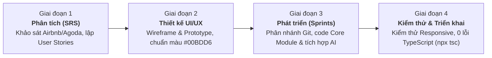

 # 🌴 Travelling App - Ứng Dụng Đặt Phòng & Trợ Lý Du Lịch Thông Minh

<p align="center">
  
</p>

<p align="center">
  <strong>Đồ án môn học: Lập trình Thiết bị Di động (Mobile App Development)</strong><br>
  Ứng dụng đa nền tảng (Android / iOS / Web) hỗ trợ tìm kiếm lưu trú, đặt phòng linh hoạt và tích hợp Trợ lý ảo AI thông minh.
</p>

<p align="center">
  
  
  
  
  
</p>

---

## 📖 1. Giới thiệu Tổng quan

**Travelling App** là ứng dụng di động hiện đại được lấy cảm hứng từ các nền tảng du lịch hàng đầu thế giới như Airbnb, Agoda và Booking.com, nhưng được tinh chỉnh tối ưu cho người dùng Việt Nam. Ứng dụng cung cấp giải pháp toàn diện từ khâu tìm kiếm điểm đến, chọn phòng, cá nhân hóa kỳ nghỉ với trợ lý ảo AI, cho đến đặt phòng, thanh toán linh hoạt và tự động xuất biên lai điện tử chuẩn PDF.

---

## ✨ 2. Tính năng Nổi bật

### 🔐 2.1. Xác thực & Tài khoản người dùng
- Đăng nhập / Đăng ký qua Email & Mật khẩu với cơ chế ghi nhớ phiên (`AuthContext` & `AsyncStorage`).
- Hỗ trợ luồng OAuth (Google, Meta/Facebook) chuẩn bị sẵn sàng qua `expo-auth-session`.
- Quản lý Hồ sơ cá nhân (`ProfileScreen`), cập nhật thông tin và đổi mật khẩu an toàn.

### 🔍 2.2. Khám phá & Tìm kiếm Thông minh
- **Trang chủ Khám phá:** Danh mục địa điểm đa dạng (Biển, Núi, Thành phố, Resort nghỉ dưỡng,...).
- **Bộ lọc đa tiêu chí:** Lọc khoảng giá theo đêm, tiện ích phòng (Wi-Fi, Hồ bơi, Bữa sáng,...), xếp hạng sao và điểm đánh giá.
- **Tìm kiếm giọng nói AI (Voice Search Modal):** Cho phép người dùng ra lệnh bằng giọng nói để tự động lọc kết quả tìm kiếm nhanh chóng.

### 🏨 2.3. Chi tiết Lưu trú & Đánh giá
- Xem chi tiết cơ sở vật chất, mô tả tiện nghi, nội quy nhận/trả phòng.
- Xem và gửi đánh giá (`ReviewsScreen`) với điểm số sao và bình luận thực tế từ khách du lịch.
- Lưu trữ danh sách phòng yêu thích (`FavoritesScreen`) với trạng thái đồng bộ tức thì.

### 🤖 2.4. Trợ lý Du lịch Ảo AI (Gemini AI Support)
- Tích hợp trực tiếp **Google Gemini API** (`aiService.ts`):
  - Gợi ý lịch trình du lịch cá nhân hóa (ví dụ: *"Gợi ý chuyến đi Đà Lạt 3 ngày 2 đêm tiết kiệm"*).
  - Tự động phân tích nhu cầu và điều hướng người dùng tới danh sách phòng phù hợp.
  - Lưu trữ lịch sử đoạn chat hỗ trợ chăm sóc khách hàng 24/7.

### 💳 2.5. Đặt phòng & Thanh toán Linh hoạt
- Tùy chọn thanh toán đa dạng:
  - **Thanh toán toàn bộ (100%)** hoặc **Thanh toán đặt cọc trước (50%)** - thanh toán phần còn lại khi nhận phòng.
- Hỗ trợ nhiều phương thức: Chuyển khoản ngân hàng (QR Code tự động), Thẻ tín dụng quốc tế (Visa/Mastercard), Ví điện tử (MoMo, ZaloPay).
- Tính toán chi phí chính xác theo số đêm và các gói dịch vụ đính kèm.

### 🧾 2.6. Xuất Biên lai & Quản lý Đặt chỗ
- **Xuất hóa đơn PDF:** Tự động tạo và chia sẻ biên lai đặt phòng chuyên nghiệp dạng PDF (`expo-print`, `expo-sharing`, `pdfGenerator.ts`).
- **Quản lý chuyến đi:** Xem danh sách phòng đã đặt, phòng đang chuẩn bị nhận và lịch sử chuyến đi (`BookingsScreen`).
- **Hộp thư thông báo (`InboxScreen`):** Cập nhật trạng thái xác nhận đặt phòng, thông báo hủy chuyến tự động.

### 🎨 2.7. Trải nghiệm Người dùng & Tùy biến (UI/UX)
- Hỗ trợ **Chế độ Sáng / Tối (Light / Dark Mode)** toàn diện qua `ThemeContext`.
- Chuyển đổi linh hoạt **Đa đơn vị tiền tệ** (VND, USD, EUR) với tỷ giá tự động chuyển đổi qua `CurrencyContext`.
- Giao diện đáp ứng mượt mà (**Responsive**) từ điện thoại màn hình nhỏ đến máy tính bảng và màn hình Web Desktop (`useResponsive.ts`).

---

## 🛠️ 3. Công nghệ & Thư viện Sử dụng

| Lĩnh vực | Công nghệ / Thư viện | Mô tả |
| :--- | :--- | :--- |
| **Nền tảng chính** | **React Native 0.88.1** & **Expo SDK 58** | Framework xây dựng ứng dụng di động Native đa nền tảng |
| **Ngôn ngữ** | **TypeScript 6.0** | Tối ưu kiểm soát kiểu dữ liệu, đảm bảo 0 lỗi biên dịch |
| **Giao diện & Icon** | `@expo/vector-icons`, `react-native-safe-area-context` | Bộ biểu tượng Ionicons và tối ưu hiển thị Safe Area tai thỏ |
| **Lưu trữ dữ liệu** | `@react-native-async-storage/async-storage` | Lưu trữ phiên đăng nhập, danh sách yêu thích, cấu hình offline |
| **Trợ lý Trí tuệ nhân tạo** | **Google Gemini API** | Xử lý ngôn ngữ tự nhiên, gợi ý hành trình và tư vấn du lịch |
| **In ấn & Chia sẻ** | `expo-print`, `expo-sharing` | Tạo mã HTML hóa đơn và kết xuất sang định dạng PDF |
| **Quản lý trạng thái** | React Context API | `AuthContext`, `ThemeContext`, `CurrencyContext` |
| **Xác thực mạng xã hội** | `expo-auth-session`, `expo-crypto`, `expo-web-browser` | Quản lý phiên OAuth bảo mật cao |

---

## 👥 4. Phân công Vai trò & Trách nhiệm Nhóm

Dự án được xây dựng và hoàn thiện bởi nhóm 3 thành viên theo mô hình **Agile / Scrum rút gọn**:

| Thành viên | Vai trò | Trách nhiệm chính trong Dự án | Đóng góp |
| :--- | :--- | :--- | :---: |
| **Đỗ Minh Thuận** *(Trưởng nhóm)* | **Mobile Dev & DevOps** | • Quản lý cấu trúc dự án, điều phối nhánh Git (`main`, `phuc`,...), review PR.<br>• Phân tích kiến trúc RESTful Mock API (`mockApi.ts`, `mockapi_clean_data.json`).<br>• Lập trình Module Xem chi tiết phòng, Đặt phòng & Thanh toán (`CheckoutScreen`, `PaymentSuccessScreen`).<br>• Xử lý chuyển đổi đa đơn vị tiền tệ (`CurrencyContext`) và cấu hình đóng gói ứng dụng. | **100%** |
| **Hồ Văn Phúc** | **Core & AI Developer** | • Tích hợp Trí tuệ nhân tạo AI Gemini hỗ trợ tư vấn du lịch thông minh (`AiSupportScreen`, `aiService.ts`).<br>• Phát triển tính năng Tìm kiếm giọng nói & Bộ lọc nâng cao (`VoiceSearchModal`, `FilterModal`).<br>• Xây dựng Hộp thư thông báo (`InboxScreen`), Lưu phòng Yêu thích (`FavoritesScreen`) & Xuất hóa đơn PDF (`pdfGenerator.ts`).<br>• Tối ưu Dark/Light mode (`ThemeContext`) và kiểm thử chất lượng mã nguồn TypeScript. | **100%** |
| **Quốc Thanh** | **UI/UX & Frontend Dev** | • Nghiên cứu trải nghiệm người dùng, thiết kế Wireframe/Prototype và hệ thống Design System (`#00BDD6`).<br>• Xây dựng màn hình Khởi động (`SplashScreen`), Xác thực tài khoản Đăng ký / Đăng nhập (`AuthScreen`).<br>• Lập trình Trang chủ Khám phá (`HomeScreen`, `CategorySelector`, `StayCard`), thanh điều hướng (`BottomTabBar`, `SidebarNav`).<br>• Hoàn thiện trang Cá nhân (`ProfileScreen`), xử lý bản địa hóa tiếng Việt và kiểm thử giao diện Responsive. | **100%** |

---

## 📁 5. Cấu trúc Thư mục Dự án

```text
Travelling-App/
├── assets/                  # Hình ảnh biểu tượng, logo, banner ứng dụng
├── src/
│   ├── api/                 # Mock API client và dữ liệu mẫu (mockapi_clean_data.json)
│   ├── components/          # Các thành phần UI dùng chung
│   │   ├── AppLogo.tsx          # Logo thương hiệu
│   │   ├── BottomTabBar.tsx     # Thanh điều hướng phía dưới màn hình
│   │   ├── CalendarPicker.tsx   # Bộ chọn lịch nhận / trả phòng trực quan
│   │   ├── CategorySelector.tsx # Thanh chọn danh mục địa điểm
│   │   ├── FilterModal.tsx      # Modal bộ lọc giá, tiện ích, loại phòng
│   │   ├── SearchHeader.tsx     # Thanh tìm kiếm đầu trang
│   │   ├── SearchModal.tsx      # Modal tìm kiếm chi tiết đa bước
│   │   ├── SidebarNav.tsx       # Thanh điều hướng bên hông (cho Tablet/Web)
│   │   ├── StayCard.tsx         # Thẻ hiển thị tóm tắt phòng/khách sạn
│   │   └── VoiceSearchModal.tsx # Modal tìm kiếm bằng giọng nói
│   ├── context/             # Quản lý State toàn cục
│   │   ├── AuthContext.tsx      # Lưu trạng thái đăng nhập, tài khoản
│   │   ├── CurrencyContext.tsx  # Quản lý tỷ giá và định dạng tiền tệ
│   │   └── ThemeContext.tsx     # Chuyển đổi Dark / Light Mode
│   ├── hooks/               # Custom React Hooks (useResponsive.ts,...)
│   ├── navigation/          # Bộ điều hướng màn hình chính (AppNavigator.tsx)
│   ├── screens/             # Toàn bộ màn hình chức năng của ứng dụng
│   │   ├── AiSupportScreen.tsx      # Trợ lý ảo AI tư vấn du lịch
│   │   ├── AuthScreen.tsx           # Đăng nhập & Đăng ký
│   │   ├── BookingsScreen.tsx       # Danh sách phòng đã đặt & lịch sử
│   │   ├── CheckoutScreen.tsx       # Điền thông tin & xác nhận thanh toán
│   │   ├── DescriptionScreen.tsx    # Mô tả chi tiết phòng
│   │   ├── FacilitiesScreen.tsx     # Tiện nghi chi tiết
│   │   ├── FavoritesScreen.tsx      # Danh sách yêu thích
│   │   ├── HomeScreen.tsx           # Trang chủ khám phá
│   │   ├── InboxScreen.tsx          # Hộp thư & Thông báo đặt chỗ
│   │   ├── PaymentSuccessScreen.tsx # Hóa đơn thanh toán thành công
│   │   ├── ProfileScreen.tsx        # Trang cá nhân & cài đặt
│   │   ├── ReviewsScreen.tsx        # Danh sách đánh giá & viết đánh giá
│   │   ├── RoomDetailScreen.tsx     # Chi tiết nơi lưu trú
│   │   ├── SearchResultsScreen.tsx  # Kết quả tìm kiếm
│   │   └── SplashScreen.tsx         # Màn hình Splash khởi động
│   ├── services/            # Tầng giao tiếp dịch vụ bên ngoài (aiService, authService, notificationService)
│   ├── types/               # Định nghĩa TypeScript Interfaces & Data Models
│   └── utils/               # Tiện ích bổ trợ (pdfGenerator.ts, vietnameseTranslations.ts)
├── .env.example             # Mẫu cấu hình biến môi trường
├── app.json                 # Cấu hình dự án Expo Application
├── package.json             # Danh sách gói phụ thuộc và scripts
├── tsconfig.json            # Cấu hình trình biên dịch TypeScript
└── README.md                # Tài liệu hướng dẫn dự án
```

---

## 🚀 6. Hướng dẫn Cài đặt & Khởi chạy

### 📋 Yêu cầu tiên quyết
- Đã cài đặt **Node.js** (Khuyến nghị phiên bản LTS `v18.x` hoặc `v20.x`).
- Đã cài đặt ứng dụng **Expo Go** trên thiết bị di động (tải từ Google Play Store hoặc Apple App Store).

### ⚙️ Các bước thực hiện

#### Bước 1: Di chuyển vào thư mục dự án
```bash
cd Travelling-App
```

#### Bước 2: Cài đặt các gói thư viện phụ thuộc
```bash
npm install
```

#### Bước 3: Cấu hình biến môi trường (`.env`)
Sao chép tệp mẫu `.env.example` thành `.env`:
```bash
cp .env.example .env
```
Mở tệp `.env` và cập nhật khóa API Google Gemini của bạn:
```env
EXPO_PUBLIC_GEMINI_API_KEY=your_gemini_api_key_here
```

#### Bước 4: Khởi động máy chủ Expo
```bash
npm run start
# hoặc
npx expo start -c
```

#### Bước 5: Mở ứng dụng để trải nghiệm
- **Trên điện thoại thật (Android / iOS):**
  - Mở ứng dụng **Expo Go** trên điện thoại.
  - Quét mã QR hiển thị trên màn hình terminal máy tính (đảm bảo điện thoại và máy tính kết nối chung mạng Wi-Fi).
- **Trên Web Browser:**
  - Nhấn phím `w` trong terminal hoặc chạy lệnh:
    ```bash
    npm run web
    ```
- **Kiểm tra mã nguồn TypeScript (Typecheck):**
  ```bash
  npx tsc --noEmit
  ```

---

## 🔄 7. Quy trình Phát triển (SDLC)

Dự án áp dụng quy trình phát triển theo mô hình **Agile / Scrum rút gọn** qua 4 giai đoạn:



---

## 📜 8. Giấy phép & Bản quyền
Dự án được phát triển nhằm mục đích học tập và nghiên cứu trong khuôn khổ môn học **Lập trình Thiết bị Di động**. Toàn bộ mã nguồn được phát hành theo giấy phép [MIT License](LICENSE).

